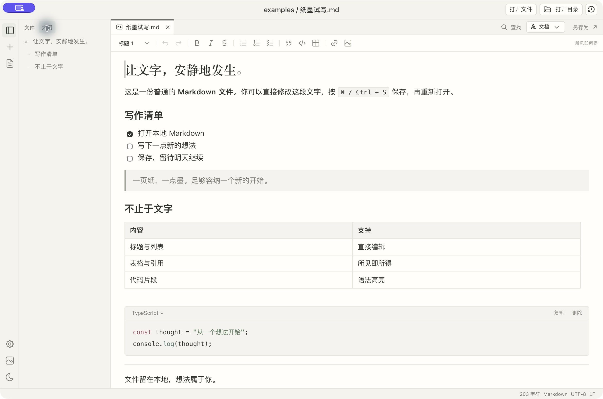
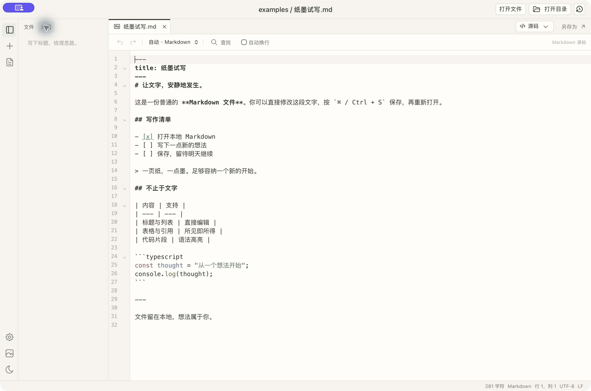
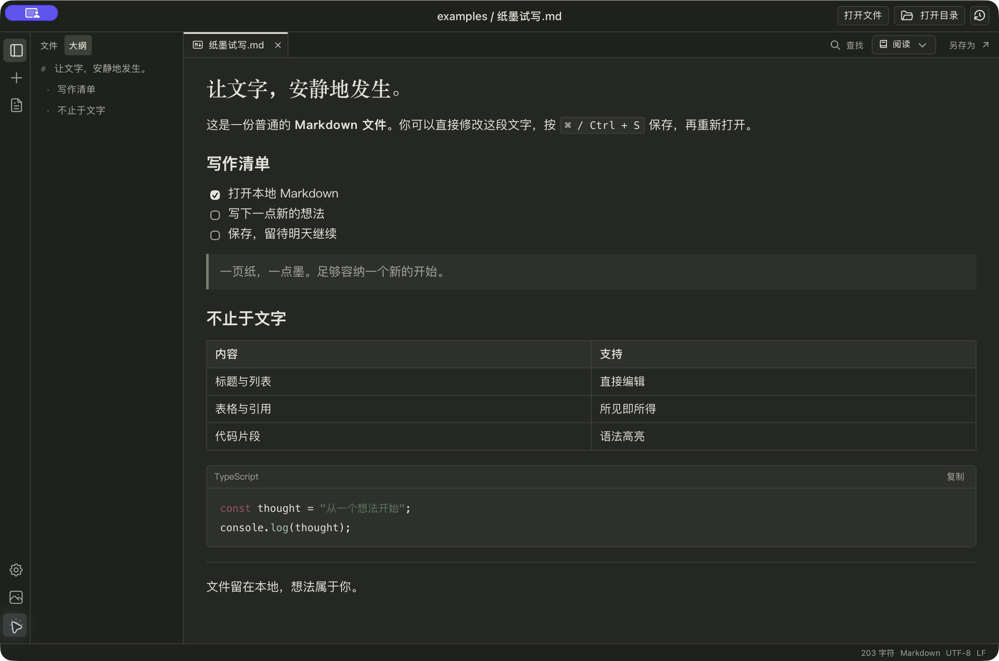

# editor-minmd

一个轻巧的本地 Markdown 编辑器。像写文档一样直接编辑，也能随时查看 Markdown 源码，偶尔打开文本或代码。

紧凑的纸墨界面，让更多空间留给正文。无需账号，文档保存在自己的电脑上。项目按 [MIT](LICENSE) 协议开源。

[下载最新版](https://github.com/tingxi8087/editor-minmd/releases/latest) · [开发与打包](doc/build.md) · [功能进展](doc/status.md) · [后续计划](doc/roadmap.md)

**当前版本：[v0.1.1](https://github.com/tingxi8087/editor-minmd/releases/tag/v0.1.1)** · 独立阅读支持脚注、公式、提示块、双链嵌入和安全 HTML，修复语法误判并加强原文保护。[查看更新说明](doc/releases/0.1.1.md)。

## 下载与开始使用

目前提供 **macOS Apple Silicon（M 系列芯片）** 安装包：

1. 在 [Releases](https://github.com/tingxi8087/editor-minmd/releases/latest) 下载 `.dmg`，打开后将应用拖到「应用程序」；也可下载 `.zip` 解压使用。
2. 点击「打开文件」编辑已有文档，或使用左侧加号新建 Markdown。
3. 用 `⌘S` 保存。需要整理多份文档时，点击「打开目录」。

当前分发包尚未经过 Apple Developer ID 签名与公证，macOS 可能提示无法验证开发者。仅在确认从本仓库下载后，按系统提示在「系统设置 → 隐私与安全性」中允许打开。Intel Mac、Windows 和 Linux 暂不提供本版安装包。

## 可以做什么

### 直接写 Markdown

- **文档 / 阅读 / 源码**三种模式，一个选择框随时切换；所有 Markdown 标签沿用同一模式，并记住选择。
- 标题、粗体、斜体、删除线、引用、列表和任务清单直接编辑。
- 表格支持行列增删、对齐和列宽调整；代码块支持语言选择、语法高亮与复制。
- 段落开头输入 `/`，插入标题、列表、表格、图片、表情、日期、本地文档链接或 Mermaid 图表。
- 支持本地图片、粘贴和拖入图片，以及网页与本地文档链接。
- 文档模式支持查找替换；阅读模式支持查找，方便专注阅读。
- 阅读模式可查看脚注、数学公式、提示块、容器、双链与本地嵌入、安全 HTML；特殊语法使用源码编辑，见[扩展阅读说明](doc/reading-mode.md)。

### 同时管理多份文件

- 打开目录浏览文件树，用顶部标签切换文件；左侧可查看标题大纲，边界可拖动调宽。
- 新建文件和文件夹、重命名、移到系统回收站；标签右键可批量关闭。
- 最近文件与目录一键继续；重启自动恢复工作目录、已保存标签和上次激活的文件。
- 设置中可勾选文件类型，将 editor-minmd 设为 macOS 默认打开应用。

### 顺手查看文本与代码

源码编辑器支持行号、语法高亮、括号匹配、折叠、语言选择和查找替换。新建文本默认不带后缀，保存时自行命名。

### 调整自己的写作环境

浅色与深色纸墨主题；可选择本地背景图片，调整模糊和遮罩，设置自动保存。正文保留清晰的纸面衬底。

## 常用快捷键

以下按 macOS 标注，完整列表可在应用「设置 → 快捷键」中查看。

| 操作 | 快捷键 |
| --- | --- |
| 新建 Markdown / 新建文本 | `⌘N` / `⌘⇧N` |
| 打开文件 / 打开目录 | `⌘O` / `⌘⇧O` |
| 保存 / 另存为 | `⌘S` / `⌘⇧S` |
| 文档 / 阅读 / 源码 | `⌘1` / `⌘2` / `⌘3` |
| 查找 | `⌘F` |
| 收起或展开侧栏 | `⌘B` |
| 关闭当前标签 | `⌘W` |
| 下一个 / 上一个标签 | `Ctrl Tab` / `Ctrl Shift Tab` |

`⌘B` 用于侧栏；粗体通过文档格式工具栏设置。

## 文件与保存

- 使用普通 Markdown 文件，不绑定专有格式；支持 UTF-8 文本与代码，单文件上限 16 MiB。
- 草稿自动保存在本机，意外退出后可恢复；仍建议及时按 `⌘S` 保存文件。
- 已打开文件被外部修改时会自动载入或提示冲突，保存前也会检查磁盘变化，防止直接覆盖。
- 文档编辑可能规范化 Markdown 写法；脚注、内嵌 HTML、数学块等可在阅读模式查看，暂不支持文档编辑时使用源码编辑，保护原文。
- 目录树目前需要手动刷新；不包含云同步或多人协作。

想先试一试，可打开仓库中的 [纸墨试写.md](examples/纸墨试写.md)。详细操作见 [表格与代码块](doc/block-interactions.md)、[斜杠菜单与 Mermaid](doc/slash-menu.md)、[图片与链接](doc/resources.md)。

## 参与项目

欢迎通过 [Issues](https://github.com/tingxi8087/editor-minmd/issues) 反馈问题和建议，附上系统版本、操作步骤及必要的示例文档。

本地开发、测试、版本管理与桌面打包见 [开发与打包说明](doc/build.md)；设计、功能现状与后续计划见 [项目文档](doc/README.md)。

源码采用 [MIT](LICENSE) 许可；第三方依赖许可见 [THIRD_PARTY_NOTICES.md](THIRD_PARTY_NOTICES.md)。
