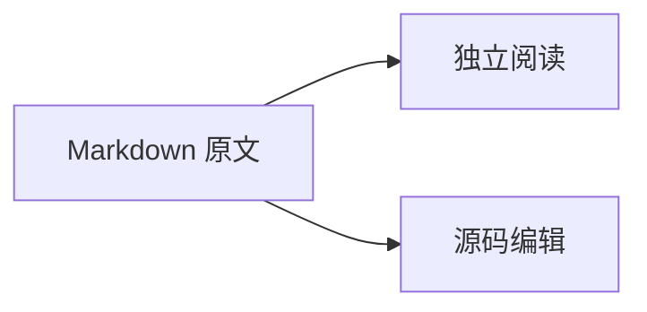

# Markdown 扩展阅读

这份示例用于阅读模式。路径示例 `build/<version>/` 应按普通行内代码显示。

## 提示与公式

> [!NOTE]
> 扩展语法可以直接阅读，修改时使用源码模式。

> [!WARNING]
> 不支持的文档编辑语法会保留原文。

行内公式：$E = mc^2$，以及 $\sqrt{a^2+b^2}$。

$$
\int_0^1 x^2\,dx = \frac{1}{3}
$$

::: tip 纸墨提示
容器里面可以有 **粗体**、列表和链接。

- [x] 本地查看
- [ ] 继续写作
:::

## 脚注与链接

这里有一条脚注[^note]，以及 [[纸墨试写|一页试写]]。

[^note]: 脚注支持 **格式**，点击返回箭头回到正文。

![[纸墨试写#不止于文字]]

## 安全 HTML

<details>
<summary>展开查看 HTML 内容</summary>
<p>HTML 可以安全展示，脚本和事件属性不会执行。</p>
</details>

行内 HTML：按 <kbd>⌘</kbd> 保存。

<!-- 注释保留在原文，阅读时不显示 -->

## 图表与原文回退



错误公式保留原文：$\notARealCommand{x}$。

```custom-language
这里是未知语言代码块，原文仍然可见。
```
